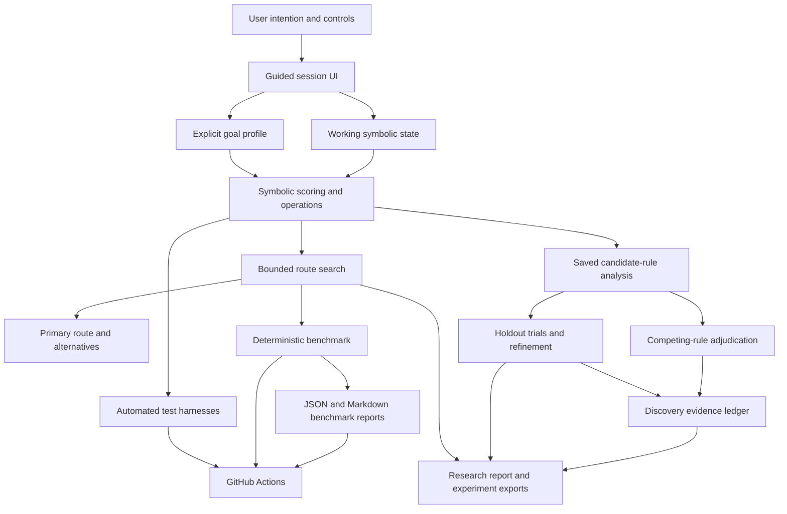

# Digital Alchemy: Architecture

This document describes the current implementation, not a future architecture. The app is a static browser application with a symbolic model and research utilities; it does not call an LLM or external scientific service.

## System map

## Main boundaries

### 1. User interface and intention

The interface gathers the starting substrate, a selected goal profile, and optional plain-language intention text. The goal selector is the operative model input. The intention sentence is stored as context and included in exports, but it is not semantically interpreted by an NLP or LLM component.

### 2. Symbolic model

The application defines a small state with four bounded component values and a stability value. Operations such as `Separate`, `Conjoin`, `Distill`, and `Fix` transform that state. A deterministic score function measures alignment with the selected goal profile.

This is a hand-defined symbolic environment. It is not a physical chemistry engine, a causal model, or a validated model of external reality.

### 3. Search

The bounded search evaluates sequences of model operations and compares endpoints using the same scoring function. The interface can show a primary route and a separate set of high-scoring distinct endpoints. The benchmark compares search depth and a state-deduplicated variant.

Search quality is therefore measured relative to the current objective. A high score means alignment with that objective, not verified practical benefit.

### 4. Rule investigation

Saved candidate rules can be evaluated on deterministic samples. The research tools include baseline comparisons, cross-goal audits, parameter stability checks, anomaly challenges, refinement, and competing-rule adjudication.

Rule refinement separates candidate tuning states from validation states. A candidate is only labelled improved if it meets the stated validation thresholds; the original rule remains unchanged. The adjudicator compares rankings on separate generated discovery and holdout samples and can report contradiction or ties.

These samples are separate within the same symbolic model. They do not provide external or real-world validation.

### 5. Evidence and exports

The Discovery Cycle orchestrates ten research stages, records stage errors, checks that expected reports are fresh, and audits preservation of the working substrate and saved rules. The evidence ledger aggregates recorded evidence types. The research report exports the currently saved browser evidence without inventing missing measurements.

Saved state and evidence are browser-local. They are not automatically synchronised to a server or across devices.

### 6. Verification and automation

The Node-based checks isolate the application script or execute it inside a lightweight DOM shim. They cover:

- JavaScript parsing and UI wiring;
- symbolic-model invariants and repeatability;
- real execution of the ten-stage Discovery Cycle;
- adversarial boundary and mixed states;
- three targeted injected faults;
- deterministic search comparisons and route replay integrity.

GitHub Actions runs the checks and benchmark on relevant pushes and on a schedule. The workflow publishes a job summary and uploads JSON/Markdown reports. It has read-only repository permissions and does not modify the application or auto-merge changes.

## Benchmark data flow

1. Generate 400 deterministic starting cases across five goal profiles.
2. Score the no-operation baseline and greedy one-step baseline.
3. Explore bounded routes through depth three.
4. Compare naive and deduplicated search.
5. Replay selected routes from the original state.
6. Repeat the benchmark and assert deterministic results.
7. Write JSON and Markdown reports as workflow artifacts.

The benchmark's current headline result is an average depth-three score of 78.933 versus 68.778 for the no-op baseline, with search beating the greedy baseline in 379 of 400 cases. This is a result inside the model, not a claim about external effectiveness.

## Current non-goals

- No autonomous source-code rewriting or auto-merging.
- No claim of general intelligence or scientific discovery.
- No real-world outcome prediction or physical chemistry simulation.
- No server-side user accounts, shared database, or cloud-synchronised experiment history.
- No automatic semantic interpretation of natural-language intentions.

## Related documents

- [README and quick start](README.md)
- [Development workbook and change history](WORKBOOK.md)
- [Live demo](https://levitatingsnake.github.io/Digital-alchemy/)
- [Overnight Lab workflow](https://github.com/levitatingsnake/Digital-alchemy/actions/workflows/overnight-lab.yml)
